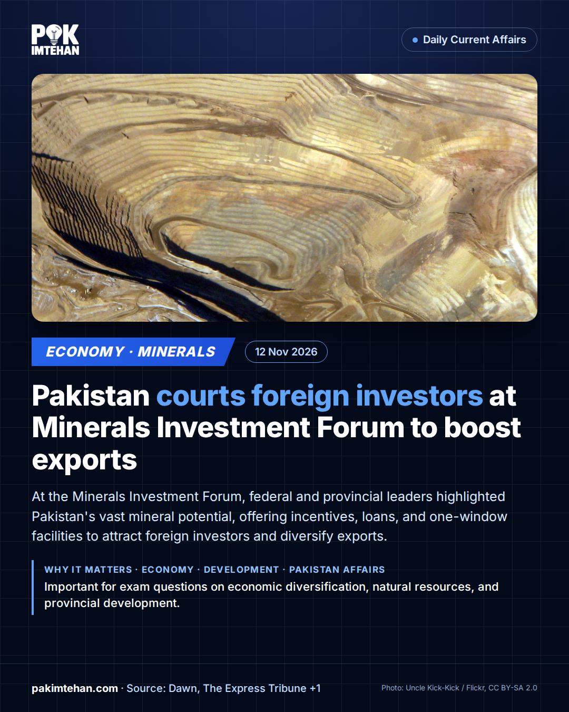

# Pak Imtehan posters — Thursday 12 November 2026

Review and approve these in the Pak Imtehan dashboard → News Posters.

## Debris from intercepted Houthi missiles falls in Saudi Arabia's Makkah region

*Fragments from intercepted Houthi missiles landed in the Sabuhah village of Saudi Arabia's Makkah region, while Pakistan expressed readiness to take necessary defensive measures to protect the Kingdom.*  
Template: `newspaper` · Source: The Express Tribune, Arab News  
Links: [1](https://tribune.com.pk/story/2639917/pakistan-ready-to-take-all-necessary-defensive-measures-to-protect-saudi-arabia-dg-ispr) · [2](https://tribune.com.pk/story/2639898/debris-from-intercepted-houthi-missiles-falls-in-saudi-arabias-makkah-region) · [3](https://news.google.com/rss/articles/CBMivAFBVV95cUxOR1JaaE1fa2VHY3FqVHd0MExGMUV4cjhBcEdVNUQ1a1FVcTN1MktFYjR2TVI4dHhhNDk5MEo3S19pTkZKMmlFX1RoRWdZeW5yd2ZoNFUwQXctbGFZSlZyckIySVdka2NwN3hqWEgwVjJqMXZVcVVYWnI0eGtoNm5Telc4XzNub0tkTXV4MUthRmg4Q1Bscm8zZVlFbVJIOUZrRFNFMVNwV0FuQWkwNVhsM1VtX3Awc1VsVU1SUw?oc=5)

## Sindh offers investment opportunities in 27 minerals, invites local, foreign investors

*Sindh Chief Minister Syed Murad Ali Shah invited domestic and foreign investors to explore investment opportunities across twenty-seven minerals available in the province.*  
Template: `navy-card` · Source: Associated Press of Pakistan  
Links: [1](https://www.app.com.pk/national/sindh-offers-investment-opportunities-in-27-minerals-invites-local-foreign-investors-cm-murad/)

## US envoys arrive in Moscow for Ukraine talks with Vladimir Putin

*US envoys arrived at the Kremlin for talks with President Vladimir Putin in a renewed push for a Ukraine peace deal, coinciding with a European leaders summit in Dublin.*  
Template: `editorial` · Source: BBC News, NPR +1  
Links: [1](https://www.france24.com/en/video/20261112-european-leaders-gather-in-dublin-to-discuss-ukraine-s-security-and-their-own) · [2](https://www.npr.org/2026/11/12/nx-s1-6037558/russia-ukraine-talks) · [3](https://www.bloomberg.com/news/articles/2026-11-12/us-envoys-witkoff-kushner-putin-talks-ukraine-zelenskyy-opportunity)
