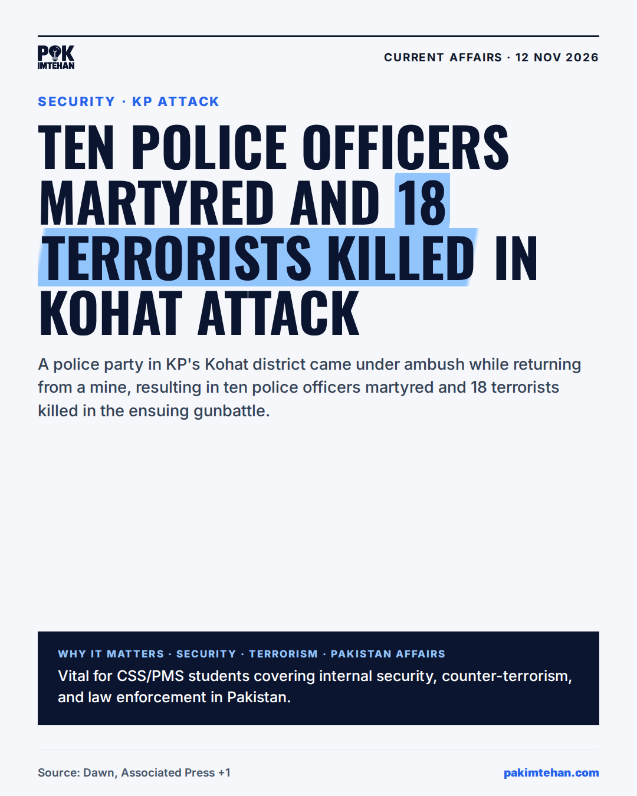
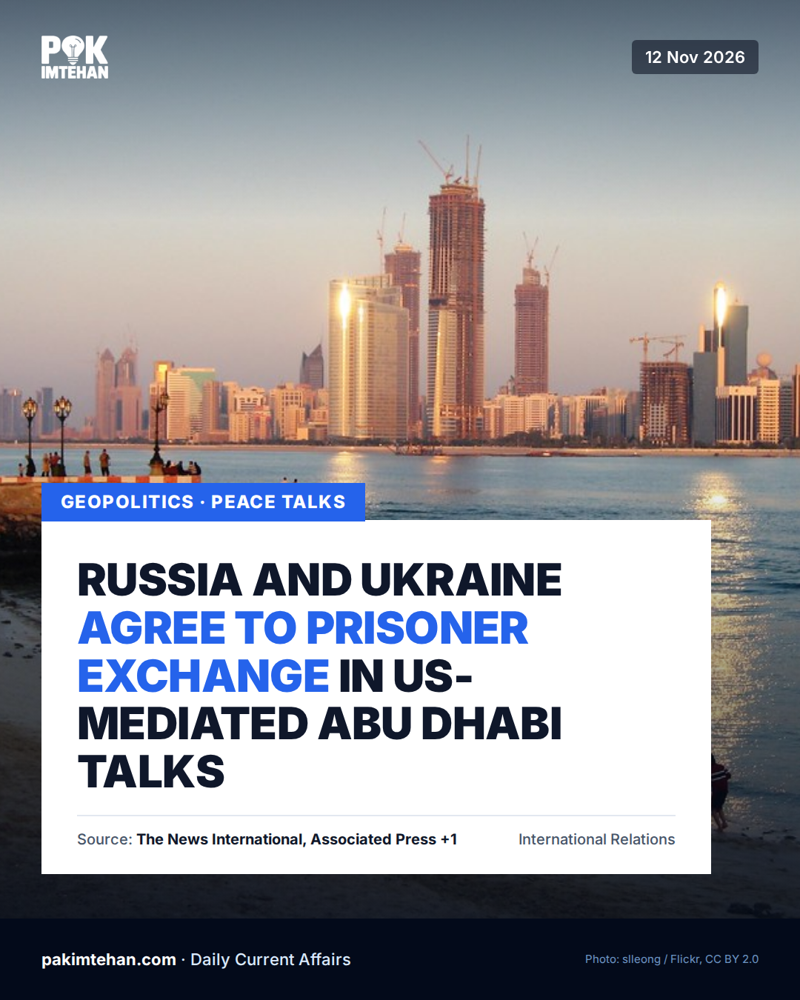

# Pak Imtehan posters — Thursday 12 November 2026

Review and approve these in the Pak Imtehan dashboard → News Posters.

## Ten police officers martyred and 18 terrorists killed in Kohat attack

*A police party in KP's Kohat district came under ambush while returning from a mine, resulting in ten police officers martyred and 18 terrorists killed in the ensuing gunbattle.*  
Template: `editorial` · Source: Dawn, Associated Press +1  
Links: [1](https://news.google.com/rss/articles/CBMiSEFVX3lxTE9ZR0VXQXBvb1I1Uk1EMW82RFBGT3ZPSmUxRTlDNEp4blgzUG9JWXNhNVQ3T2VTc0llMmRsakpqdTdMaFAwemVVRw?oc=5) · [2](https://news.google.com/rss/articles/CBMitAFBVV95cUxQLUlPajFoQ0JJek9uOW5KdHMyV2tZT3I4V1FNTWtlcXpqR2JFMVBHNkRPc21yNmdWVHNPbXlZVDVZTnF2RTJSYkE3RUE5ZkNYWDdlaGR0WkcwbGJMSjhLYThJcnZvX25QcnlVb2llSTBKbWdyZkdnQUhfX09taGptZEstTnlsTjNSV0JRVS1YbWNVOHJHWlhoXy14eGRnNDRzdnFYaWg5YUhEOEllSGM3cXdOZEs?oc=5) · [3](https://www.aljazeera.com/news/2026/11/12/ten-police-officers-18-fighters-killed-in-northwest-pakistan-attack?traffic_source=rss)

## Pakistan courts foreign investors at Minerals Investment Forum to boost exports

*At the Minerals Investment Forum, federal and provincial leaders highlighted Pakistan's vast mineral potential, offering incentives, loans, and one-window facilities to attract foreign investors and diversify exports.*  
Template: `navy-card` · Source: Dawn, The Express Tribune +1  
Links: [1](https://news.google.com/rss/articles/CBMiSEFVX3lxTE1sYWE1NkU1ZmRQbVdyaUVIdGkzVzJVeDlURE96QVFfb0QyOWl2VkR0RG9xVFE3eGJSYnZ4OThJaXJZTU90Uzc5bw?oc=5) · [2](https://tribune.com.pk/story/2639911/pakistan-courts-global-investors-at-minerals-investment-forum-as-provinces-outline-opportunities) · [3](https://www.app.com.pk/national/cm-maryam-offers-incentives-to-mineral-investors-interest-free-loans/) · [4](https://www.app.com.pk/national/kp-governor-invites-international-investors-announces-one-window-facility-for-mining-sector/)

## Russia and Ukraine agree to prisoner exchange in US-mediated Abu Dhabi talks

*U.S.-mediated peace talks in Abu Dhabi between Russia and Ukraine concluded with an agreement on a large exchange of prisoners of war, though negotiations ended without a major diplomatic breakthrough.*  
Template: `breaking-photo` · Source: The News International, Associated Press +1  
Links: [1](https://news.google.com/rss/articles/CBMi1AFBVV95cUxNU0RaTUV6WkVNLVZtTlR6WnFTTFE4VEp6d3ZqdGF6dEV5aVNuRVhNZ1M0LTFXZE9HaEhCcy15YjhnQV9jUWZSYVQ5bW1vSkUtUmNLeFI5V1BrOEQ5dEU4MjU5SFkzSTNJa1l0WGJjRGhsQkxnVUFDenRtSWtia25OM1hRbzV3dTJnS2xXV2tJMUw0UmZzbld3MlQ4a1ExbzRsN3dtUHRkaGVvaHVHWXN6VDJ1LWVNUWJIcGlUR0VnSF93TTk1WnJ6VlFZV1V1bklzY01WQtIB1AFBVV95cUxNU0RaTUV6WkVNLVZtTlR6WnFTTFE4VEp6d3ZqdGF6dEV5aVNuRVhNZ1M0LTFXZE9HaEhCcy15YjhnQV9jUWZSYVQ5bW1vSkUtUmNLeFI5V1BrOEQ5dEU4MjU5SFkzSTNJa1l0WGJjRGhsQkxnVUFDenRtSWtia25OM1hRbzV3dTJnS2xXV2tJMUw0UmZzbld3MlQ4a1ExbzRsN3dtUHRkaGVvaHVHWXN6VDJ1LWVNUWJIcGlUR0VnSF93TTk1WnJ6VlFZV1V1bklzY01WQg?oc=5) · [2](https://news.google.com/rss/articles/CBMiogFBVV95cUxPZGJLX21sUk93S0w1eDdOMEtDdC1ETk4zZ0E4d1dna2xHaWxFSXIxdGFFYVV0Wm5pWlc1Uk5YczNsa09FcGJtMHpKU1VnTkVJejR2YTJxR0ZFQXE3dndEcS0teGNKbHJBS3R1N1lHbUxuR3hOQ3hyZ2s5elFlbkFBVTJMNmE3TW1vN2x5dDl2VzBvWWpiWU5WRGxBLWJTNVZBUUE?oc=5) · [3](https://www.npr.org/2026/11/11/g-s1-152954/russia-ukraine-war-talks)
