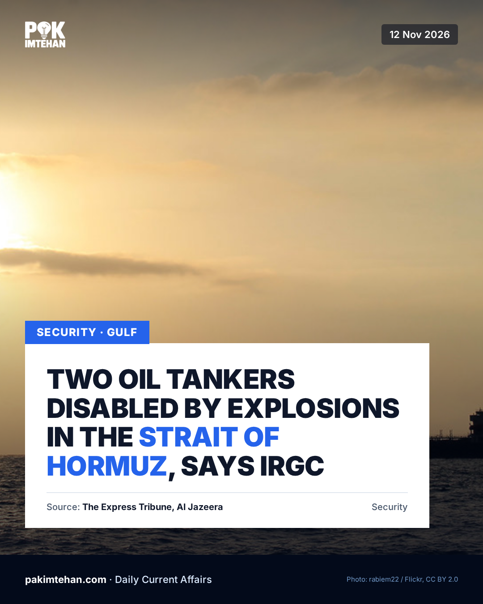

# Pak Imtehan posters — Thursday 12 November 2026

Review and approve these in the Pak Imtehan dashboard → News Posters.

## Pakistan Aims to Value-Add Minerals as Mari Energies Signs Deal With Ivanhoe

*Foreign Minister Ishaq Dar stated Pakistan aims to build processing and refining capacity rather than exporting raw minerals. Meanwhile, Canadian Ivanhoe Mines signed an MoU with Mari Energies.*  
Template: `breaking-photo` · Source: Dawn, Business Recorder  
Links: [1](https://www.dawn.com/news/2044014/canadian-mining-company-signs-mou-with-mari-energies-in-south-asia-push) · [2](https://www.brecorder.com/news/40448594/pakistan-aims-to-move-beyond-raw-mineral-exports-says-dar)

## Interior Minister Proposes Referendum to Resolve Debate on New Administrative Units

*Interior Minister Mohsin Naqvi suggested political parties hold a referendum to gauge public opinion on creating new provinces and administrative units, calling it a solution to the ongoing debate.*  
Template: `brief-light` · Source: Dawn, The Express Tribune  
Links: [1](https://www.dawn.com/news/2044043/naqvi-suggests-referendum-as-solution-to-debate-on-new-administrative-units) · [2](https://tribune.com.pk/story/2639930/bilawal-and-i-almost-on-same-page-over-system-reset-naqvi)

## Karachi Inaugurates Pakistan’s First Sponge Park to Conserve Rainwater

*Karachi has launched Pakistan's first sponge park, a six-month project designed to reduce urban flooding, recharge groundwater, and reuse filtered rainwater for irrigation purposes.*  
Template: `editorial` · Source: The Express Tribune  
Links: [1](https://tribune.com.pk/story/2639920/karachi-inaugurates-pakistans-first-sponge-park-to-conserve-rainwater)

## Nepra Notifies Revised Rs25.30 Industrial Electricity Tariff Package

*Nepra notified a revised incremental consumption package of Rs25.30 per unit for industry and agriculture to encourage higher power consumption despite concerns.*  
Template: `typographic` · Source: Dawn  
Links: [1](https://www.dawn.com/news/2044061/nepra-notifies-rs2530-per-unit-revised-special-industrial-tariff-despite-concerns)

## Chinese President Xi Jinping Calls for Peaceful Reunification With Taiwan

*Chinese President Xi Jinping stated that Taiwan's peaceful reunification is an unstoppable historical trend, while making no mention of military force. Taiwan promptly rejected Beijing's demands.*  
Template: `newspaper` · Source: Dawn, DW News  
Links: [1](https://www.dawn.com/news/2044041/chinas-xi-says-taiwan-reunification-must-happen-as-history-cannot-be-stopped) · [2](https://www.dw.com/en/china-s-xi-jinping-renews-calls-for-reunification-with-taiwan/a-79929738?maca=en-rss-en-world-4025-rdf)
