# Pak Imtehan posters - 2026-11-13

30 poster(s) in 2 batch(es).

## Batch 12:47 (Pakistan time)

### Security forces kill 74 terrorists in KP and Balochistan operations
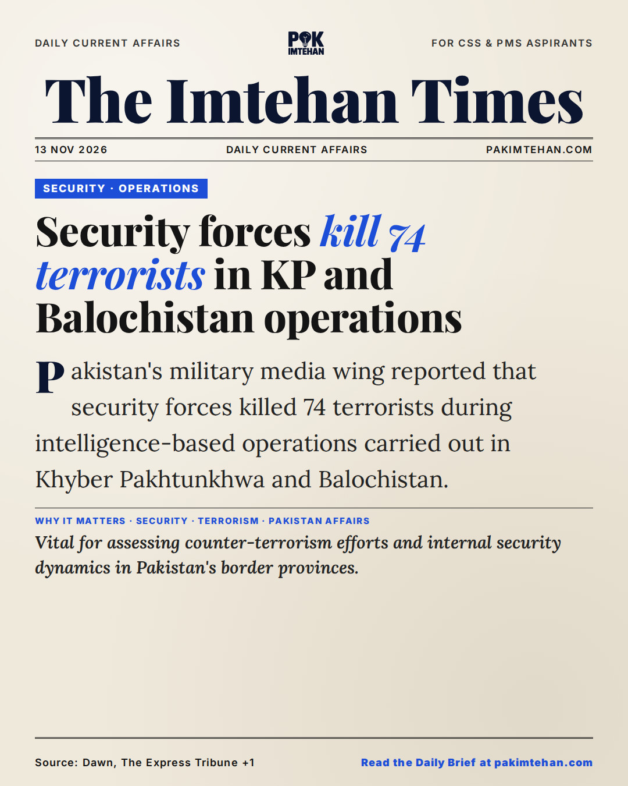
*Pakistan's military media wing reported that security forces killed 74 terrorists during intelligence-based operations carried out in Khyber Pakhtunkhwa and Balochistan.*  
Template: `newspaper` · Source: Dawn, The Express Tribune +1 · Editor: `gemini:gemini-3.6-flash`  
Links: [1](https://www.dawn.com/news/2044260/security-forces-kill-74-terrorists-during-ibos-in-khyber-pakhtunkhwa-balochistan-ispr) · [2](https://tribune.com.pk/story/2640081/security-forces-kill-31-terrorists-in-balochistan-operations-ispr) · [3](https://www.brecorder.com/news/40448742/security-forces-kill-74-terrorists-in-balochistan-kp-operations-ispr)

### Pakistan focuses mineral exploration on strategic global resources

*Petroleum Minister Ali Pervaiz Malik stated that Pakistan is shifting its mineral exploration focus toward resources of strategic value to global investors during an address at Pakistan Minerals.*  
Template: `brief-light` · Source: Dawn · Editor: `gemini:gemini-3.6-flash`  
Links: [1](https://www.dawn.com/news/2044267/pakistans-mineral-exploration-increasingly-focused-on-strategic-resources-minister-tells-investors)

### UNSC updates Yemen sanctions as Pakistan urges end to Houthi attacks
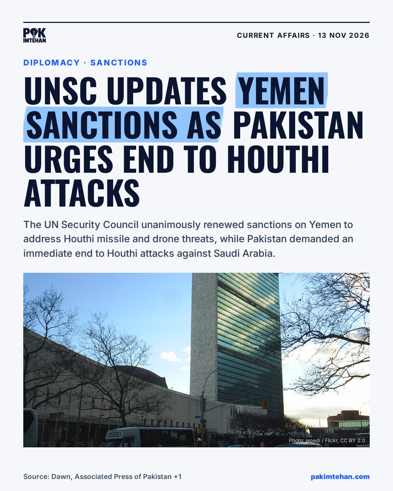
*The UN Security Council unanimously renewed sanctions on Yemen to address Houthi missile and drone threats, while Pakistan demanded an immediate end to Houthi attacks against Saudi Arabia.*  
Template: `editorial` · Source: Dawn, Associated Press of Pakistan +1 · Editor: `gemini:gemini-3.6-flash`  
Links: [1](https://www.dawn.com/news/2044254/pakistan-calls-for-immediate-end-to-houthi-attacks-on-saudi-arabia-as-unsc-renews-yemen-sanctions) · [2](https://www.app.com.pk/foreign-correspondent/unsc-updates-yemen-sanctions-regime-to-address-houthi-threats-pakistan-slams-attacks-on-saudi-arabia/) · [3](https://news.google.com/rss/articles/CBMizgFBVV95cUxOUlBZLTd5ZU9sLWVMaTUxc2llWGdnNEZnemR2VmdEdXpQX0h2RkJ4ajUwNUJaUDlEenl4dFlOb0FBOXRkUWNhNGhUU3RTcUI3YjBtZGNvRG9uVm81SUdGUTF4b01kRVBCdkg5ejFROTVQLTZocVZhN212dmdDYW82VjdibDlzc25lNmJjSVBjRnppelptNEpvTDNBN3BZYUM0U240cHFZeWoyMlNXR0tSTzZPVURQWDNGdEpuVVNHVUlmRFpBTEtKcUpFZ3Rqdw?oc=5)

### Delhi overtakes Lahore as world's most polluted city amid severe smog
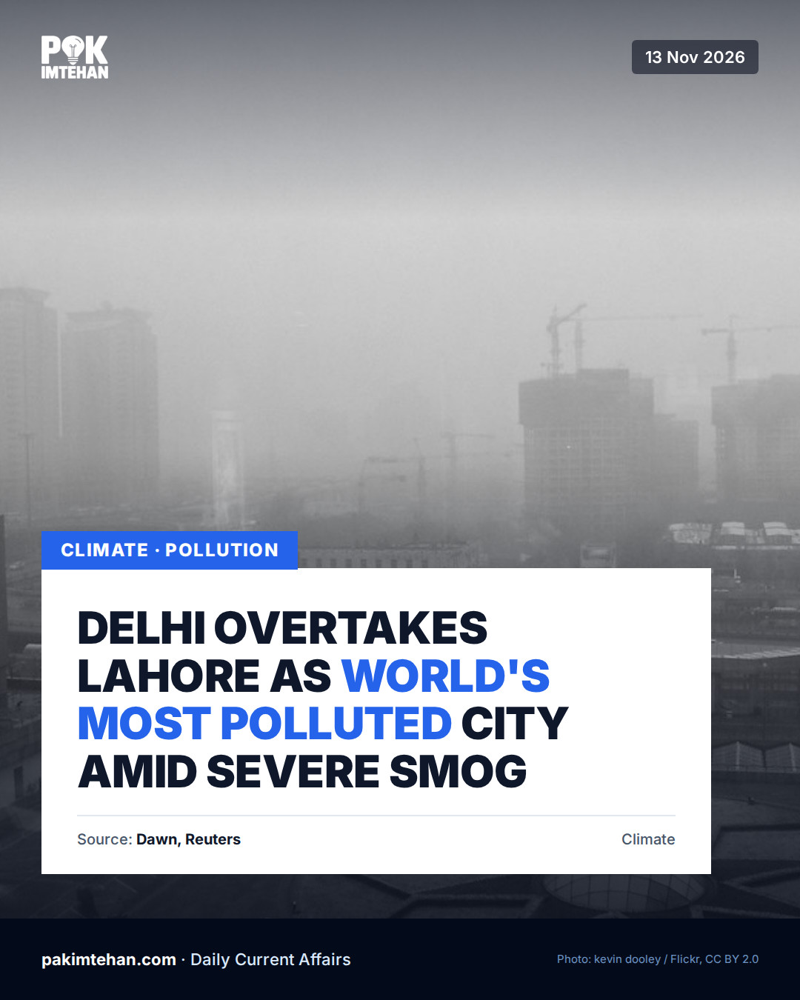
*Delhi surpassed Lahore as the world's most polluted major city as hazardous air quality and dense smog blanketed the Indian capital, drastically reducing visibility for its 20 million residents.*  
Template: `breaking-photo` · Source: Dawn, Reuters · Editor: `gemini:gemini-3.6-flash`  
Links: [1](https://www.dawn.com/news/2044265/delhi-overtakes-lahore-as-worlds-most-polluted-major-city-as-air-quality-deteriorates) · [2](https://news.google.com/rss/articles/CBMiwAFBVV95cUxQTDFhYWxpT2NaY1pyQmI2UU9LZGZJdTlEQ2wwbGxGNHJnbGxOUmdDWVJMQ0VUMXk5NmpBMTJoZXJzTGJuRDZnU09DT0gxTWFqRjlyTk4zSUZqRXlVb1NYTEJRaTVBMUpRcm9nTzZHTUJzanJlcVZOSE1UczBpZXdkdS1WRFVQWFJ2LTROZVVkZEt1dUF6d2NPZU0zbFVsZ0I0R012SUp2OXhEVDFJUTNTVUplbGd1cXBnS0laV2RJczE?oc=5)

### Microsoft global outage disrupts Outlook and Teams for businesses
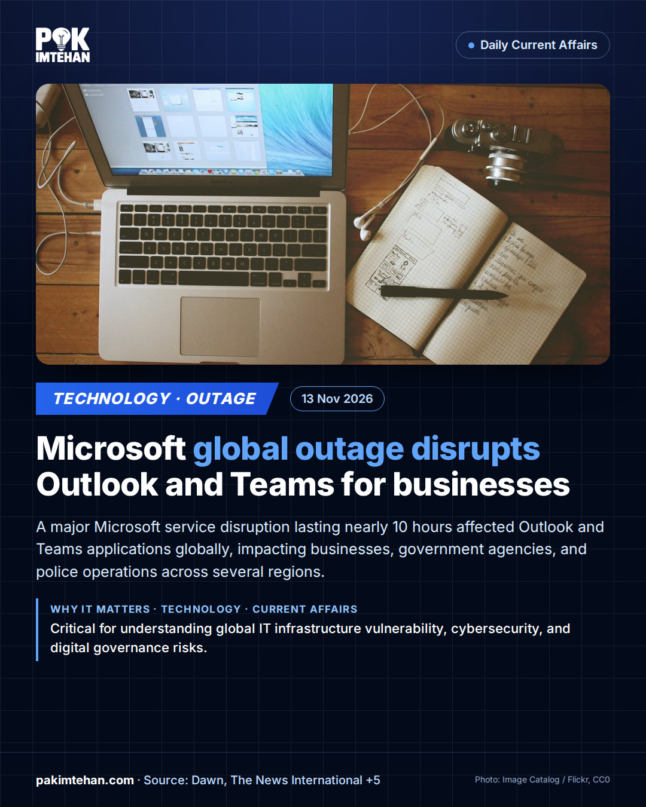
*A major Microsoft service disruption lasting nearly 10 hours affected Outlook and Teams applications globally, impacting businesses, government agencies, and police operations across several regions.*  
Template: `navy-card` · Source: Dawn, The News International +5 · Editor: `gemini:gemini-3.6-flash`  
Links: [1](https://www.dawn.com/news/2044258/microsoft-outage-drags-on-for-hours-disrupting-outlook-teams-for-businesses-and-governments) · [2](https://news.google.com/rss/articles/CBMimAFBVV95cUxQTGpWWXlfQ2tIXzBnTVdIODlXelpqVWNLVHlNV0pJNDFONmgxMUk2SWtaMGZHMU1Vd2lNT1ptUkwzSEowNnNpR0ltRWhERkhDZjRlV1RCSUxIcHdPdEZkSi1EYXNoX2h1NEgtQnhVRVZQOU1lOU5qa2RfQy1Ka05yOGlrU0IyRkhGM3RRallmLTFScUhLbzZBMtIBmAFBVV95cUxQTGpWWXlfQ2tIXzBnTVdIODlXelpqVWNLVHlNV0pJNDFONmgxMUk2SWtaMGZHMU1Vd2lNT1ptUkwzSEowNnNpR0ltRWhERkhDZjRlV1RCSUxIcHdPdEZkSi1EYXNoX2h1NEgtQnhVRVZQOU1lOU5qa2RfQy1Ka05yOGlrU0IyRkhGM3RRallmLTFScUhLbzZBMg?oc=5) · [3](https://news.google.com/rss/articles/CBMisAFBVV95cUxPQWpWeUZnbllhcFk4WktZS0s3T1N6T3k3Vnhhd3pfSE9SWF9iRmRIQUljdHZXN0UtWS1uZS1rbUNZSlVPd1NXLXRtVUVtc3NQNTgxMVFMWjVnT3pPb09EX1g1YUx3WkF2VHk0bUMwWlhkRHdpT0JFRE5SQ3pQRkdmSnpUOHNXLUo1dXNSY3lFdkpSdU5laDdwSlhWRDVnNjBFcUh2Y0FwMXNldE8tSFpPaw?oc=5) · [4](https://news.google.com/rss/articles/CBMinAFBVV95cUxOb2ZUZnZ6Z1JPSWM2YWVQel9wdC14MWloZ3FvX084b1RFcmRsUWhNZFJGSjZxd1hOOWZsb2ZEbTVqVWx3Zkl1T01TY21QUTRHVGRsUmF5bUx3UDctd0lJOGZlblJFYjRIMFEyNkZGTFl1R05jYS1PXzNXSWhIMHgtRDkwLU1XNTFUZmkxbGhoRS1CbWpKMHhfbFFWdlA?oc=5) · [5](https://www.theguardian.com/technology/2026/nov/13/major-microsoft-outage-impacts-australian-government-services-and-schools) · [6](https://www.ft.com/content/025b2769-bca8-4a74-b9f5-5d7ad7da32c7?syn-25a6b1a6=1) · [7](https://news.google.com/rss/articles/CBMigAFBVV95cUxNdExpN1FGbnZWR1J6TmZDU1lqT0hsU2xUOHlnTFJpX2NtQ1o4aDAzQ1A0UTI4NWRRVEdaNlZKTFd3VXBGYmtIQWZPeWJ0b1pxd1d6Q181Q0otOVZlX3J1UUk5T1F0dlpMZGxwZ1FuUTBKTC1mdzhzcjBUWGhoLWZHRw?oc=5)

### Peshawar police ban private jirgas to curb illegal dispute resolution

*Police in Peshawar have prohibited private jirgas from holding dispute resolution meetings in wedding halls and hotels, citing concerns over gun culture, violent clashes, and high monetary charges.*  
Template: `typographic` · Source: Dawn · Editor: `gemini:gemini-3.6-flash`  
Links: [1](https://www.dawn.com/news/2044193/police-ban-private-jirgas-in-peshawar)

### Nishat Group announces investment in Pakistan's proposed new port
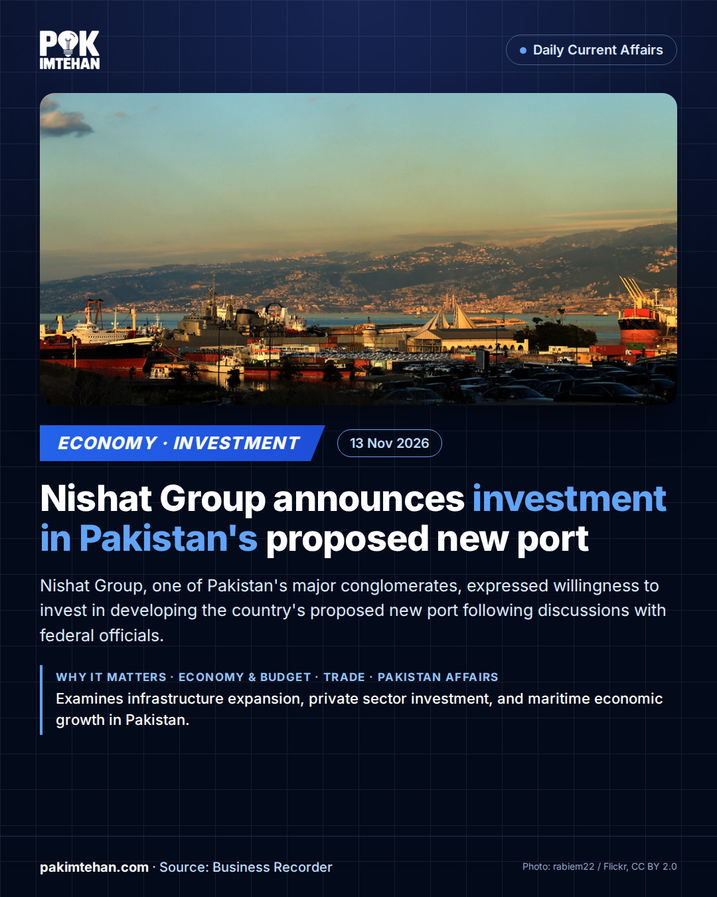
*Nishat Group, one of Pakistan's major conglomerates, expressed willingness to invest in developing the country's proposed new port following discussions with federal officials.*  
Template: `navy-card` · Source: Business Recorder · Editor: `gemini:gemini-3.6-flash`  
Links: [1](https://www.brecorder.com/news/40448749/manshas-nishat-group-to-invest-in-pakistans-new-port)

### Government extends subsidy on Raast QR merchant payment charges

*Prime Minister Shehbaz Sharif decided to maintain the subsidy on merchant discount rate charges for Raast QR payments to promote digital payment adoption across merchants nationwide.*  
Template: `brief-light` · Source: Business Recorder · Editor: `gemini:gemini-3.6-flash`  
Links: [1](https://www.brecorder.com/news/40448745/govt-moves-to-continue-subsidy-for-raast-qr-payments)

### Japanese PM Sanae Takaichi to visit China for APEC summit in Shenzhen
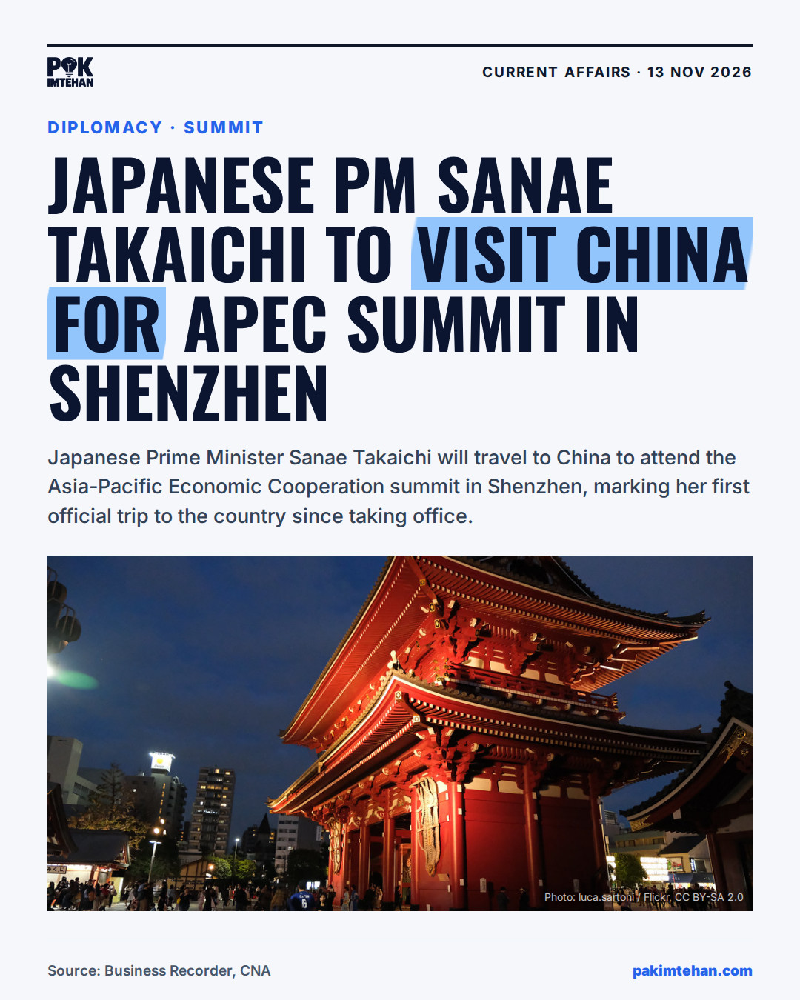
*Japanese Prime Minister Sanae Takaichi will travel to China to attend the Asia-Pacific Economic Cooperation summit in Shenzhen, marking her first official trip to the country since taking office.*  
Template: `editorial` · Source: Business Recorder, CNA · Editor: `gemini:gemini-3.6-flash`  
Links: [1](https://www.brecorder.com/news/40448748/takaichi-to-attend-apec-in-first-china-trip-as-pm) · [2](https://www.channelnewsasia.com/east-asia/japan-sanae-takaichi-first-china-trip-apec-summit-6548471)

### US envoys hold peace talks with Russia and Ukraine amid prisoner swap

*US envoys held discussions with leaders in Moscow, Kyiv, and Dublin to negotiate a Russia-Ukraine peace framework, reaching an agreement on prisoner exchanges while debating European inclusion.*  
Template: `breaking-photo` · Source: Al Jazeera, DW News +4 · Editor: `gemini:gemini-3.6-flash`  
Links: [1](https://www.aljazeera.com/video/newsfeed/2026/11/13/aje-onl-nf_us-envoys-shuttle-between-putin-and-zelenskyy-121126?traffic_source=rss) · [2](https://www.dw.com/en/eu-leaders-tussle-over-whom-to-send-to-ukraine-russia-peace-talks/a-79935468?maca=en-rss-en-world-4025-rdf) · [3](https://www.dw.com/en/what-have-the-talks-with-russia-and-the-us-in-abu-dhabi-achieved-for-ukraine/a-79930613?maca=en-rss-en-world-4025-rdf) · [4](https://news.google.com/rss/articles/CBMiiAFBVV95cUxNWlUzQnd4TkRvc3VTVGZURnp3M3ZrTFhkSXYwM2oyaDNOVTFHQnFDZW1oRVRmNEllVVp6WTVQVUNLVm85TjljZkFCNlRMZEpqX3M4VVlXUTlpVUJVcUp6NGZ3WnFyZ1gzaWNBb3hkZmlIWVpXdTZHMmFqUGpfMll3OWotdXpfd3FF?oc=5) · [5](https://news.google.com/rss/articles/CBMihwFBVV95cUxORlViM2FXYmJzdEtvRUk0em9kVmpjZXlvNVBRSUhqNXljeVkwUmQ1Zm5wVGp5WEo5SEQxajhUOF9leFFSTUhvRkhHWlpnLU14ajhtd0oxcHRDWktGakJucWJadl9SdHhYZ2RUWllFYk9TNW96VEJObTZQZHFiSDRoZ2syYlFjVTQ?oc=5) · [6](https://www.npr.org/2026/11/12/nx-s1-6037526/former-u-s-ambassador-william-taylor-discusses-the-latest-russia-ukraine-talks) · [7](https://www.npr.org/2026/11/12/nx-s1-6037558/u-s-officials-set-to-meet-with-putin-zelenskyy-following-abu-dhabi-peace-talks) · [8](https://www.bloomberg.com/news/videos/2026-11-13/zelenskyy-says-talks-with-us-envoys-in-dublin-made-progress) · [9](https://www.ft.com/content/73e518cb-14c5-4012-acea-3a3d01725b1b)

### Nvidia CEO Jensen Huang resigns following affair and espionage probe
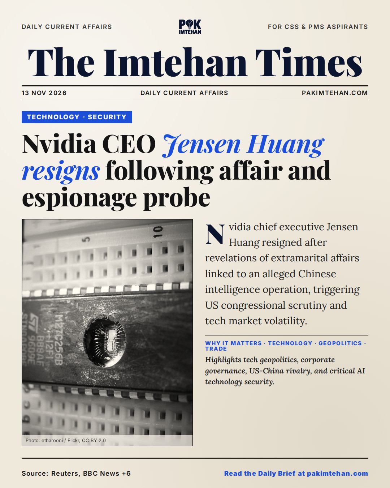
*Nvidia chief executive Jensen Huang resigned after revelations of extramarital affairs linked to an alleged Chinese intelligence operation, triggering US congressional scrutiny and tech market volatility.*  
Template: `newspaper` · Source: Reuters, BBC News +6 · Editor: `gemini:gemini-3.6-flash`  
Links: [1](https://news.google.com/rss/articles/CBMisAFBVV95cUxOMEFwN0FWdjB6blNtR0RZaTBWZXZDaWVwYkhXREttY2FaYVNNVC1qNEFHYm9Yd1pDODBDN2tvNzhnMTY4cmxWYTg1WVFidzFlNVFEdlZNb3IyZG1nS2FKcHAzUERhQW9EdG9oOER6YmwydXZOd0t1VHRub1BCdFdoR1V4dktlUVUydjZWeU53aVdKMGwtOGFtZmd2T3VhODF3eXhPazVtbV81b0hpUi1vcw?oc=5) · [2](https://www.bbc.co.uk/news/articles/cmq5vd1wdgz6o?at_medium=RSS&at_campaign=rss) · [3](https://www.dw.com/en/jensen-huang-spy-row-affairs-leave-nvidia-without-its-rockstar-ceo/a-79926972?maca=en-rss-en-world-4025-rdf) · [4](https://www.france24.com/en/tv-shows/business/20261112-jensen-huang-resigns-as-nvidia-ceo-after-mounting-scandals) · [5](https://www.euronews.com/2026/11/12/who-is-alice-huang-the-alleged-chinese-spy-linked-to-nvidias-jensen-huang) · [6](https://www.pbs.org/newshour/economy/nvidia-ceo-jensen-huang-resigns-after-his-affair-raises-national-security-concerns) · [7](https://www.bloomberg.com/news/videos/2026-11-13/ronner-says-nvidia-turmoil-so-far-appears-idiosyncratic-video) · [8](https://www.bloomberg.com/news/articles/2026-11-13/nvidia-crisis-prompts-scrutiny-of-lutnick-s-role-in-chip-policy) · [9](https://www.cnbc.com/2026/11/12/alice-huang-jensen-huang-nvidia-huawei.html) · [10](https://www.theguardian.com/technology/2026/nov/13/nvidia-scandal-sparks-us-national-security-concerns-china) · [11](https://www.theguardian.com/world/2026/nov/12/thursday-briefing-what-we-do-and-dont-know-about-alice-huang-and-the-nvidia-affair)

### Indonesian Vice President resigns amid academic credentials controversy
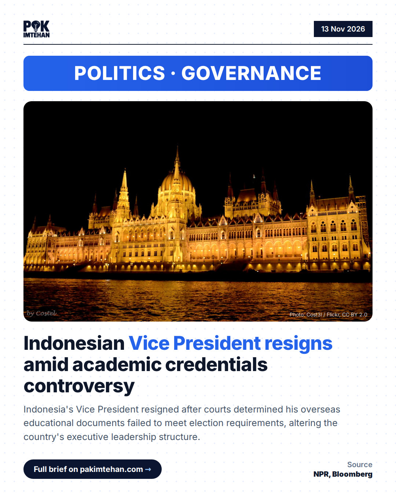
*Indonesia's Vice President resigned after courts determined his overseas educational documents failed to meet election requirements, altering the country's executive leadership structure.*  
Template: `brief-light` · Source: NPR, Bloomberg · Editor: `gemini:gemini-3.6-flash`  
Links: [1](https://www.npr.org/2026/11/12/g-s1-153190/indonesias-vp-resigns-as-his-eligibility-and-academic-credentials-are-questioned) · [2](https://www.bloomberg.com/news/articles/2026-11-12/jokowi-era-fades-in-indonesia-with-son-forced-out-as-prabowo-s-vice-president)

### Senator Chris Van Hollen challenges Chuck Schumer for US Senate leader
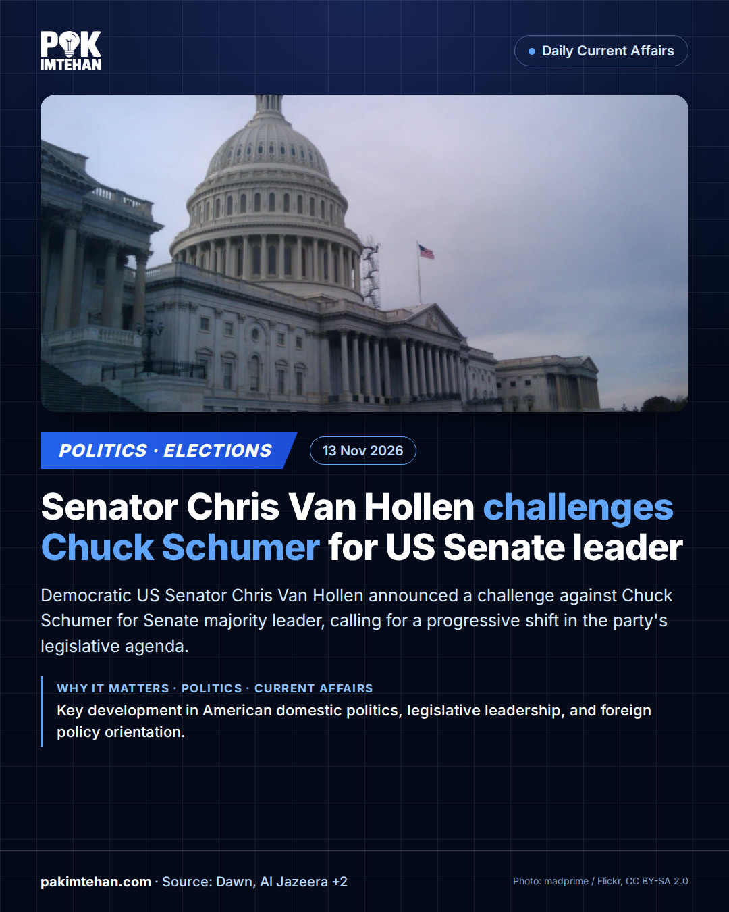
*Democratic US Senator Chris Van Hollen announced a challenge against Chuck Schumer for Senate majority leader, calling for a progressive shift in the party's legislative agenda.*  
Template: `navy-card` · Source: Dawn, Al Jazeera +2 · Editor: `gemini:gemini-3.6-flash`  
Links: [1](https://www.dawn.com/news/2044266/democratic-us-senator-chris-van-hollen-announces-run-for-us-senate-majority-leader-challenging-schumer) · [2](https://www.aljazeera.com/news/2026/11/13/who-is-us-senator-chris-van-hollen?traffic_source=rss) · [3](https://www.euronews.com/2026/11/13/us-senator-chris-van-hollen-to-challenge-chuck-schumer-for-senate-majority-leader) · [4](https://www.bloomberg.com/news/articles/2026-11-13/van-hollen-challenges-schumer-for-senate-leader-in-new-congress)

### Pope Leo XIV meets abuse survivors in Peru and denounces machismo

*Pope Leo XIV met clergy abuse survivors during his visit to Peru, urging the Catholic Church to make amends while publicly calling for an end to violence against women and machismo.*  
Template: `breaking-photo` · Source: Al Jazeera, France 24 +1 · Editor: `gemini:gemini-3.6-flash`  
Links: [1](https://www.aljazeera.com/video/newsfeed/2026/11/13/aje-onl-nf_pope-leo-meets-clergy-abuse-survivors-in-peru-121126?traffic_source=rss) · [2](https://www.france24.com/en/americas/20261113-pope-leo-xiv-meets-abuse-victims-in-peru-says-church-must-make-amends) · [3](https://www.france24.com/en/tv-shows/spotlight/20261112-peruvian-pope-leo-xiv-comes-home-to-a-country-that-shaped-his-life-and-faith-through-hardship) · [4](https://www.pbs.org/newshour/world/after-emotional-return-pope-leo-denounces-machismo-in-peru-and-demands-respect-for-women)

### Ishaq Dar demands global standard restructuring of Pakistan National Shipping
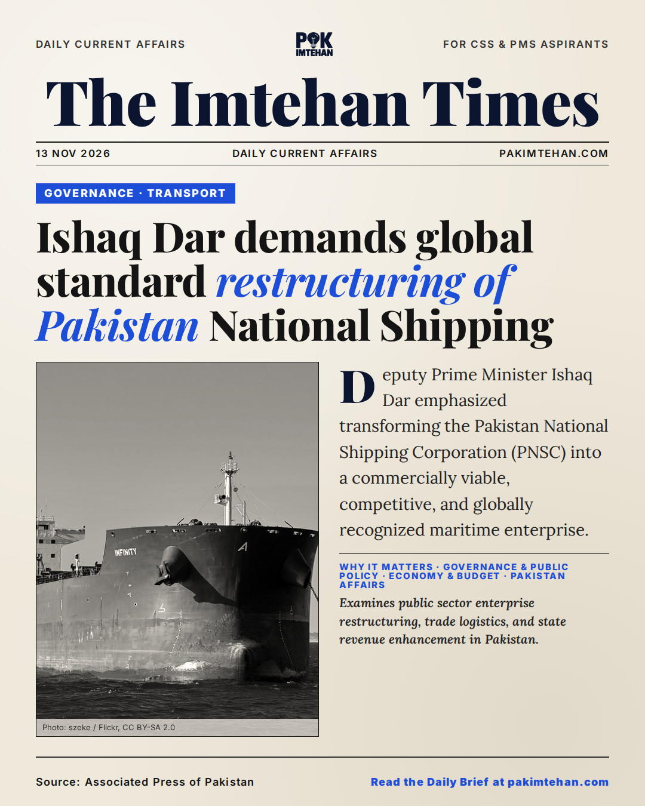
*Deputy Prime Minister Ishaq Dar emphasized transforming the Pakistan National Shipping Corporation (PNSC) into a commercially viable, competitive, and globally recognized maritime enterprise.*  
Template: `newspaper` · Source: Associated Press of Pakistan · Editor: `gemini:gemini-3.6-flash`  
Links: [1](https://www.app.com.pk/national/dpm-dar-for-professional-global-standard-restructuring-of-pnsc/)

## Batch 10:27 (Pakistan time)

### At COP31, PM Shehbaz calls for grant-based finance and resilience funding
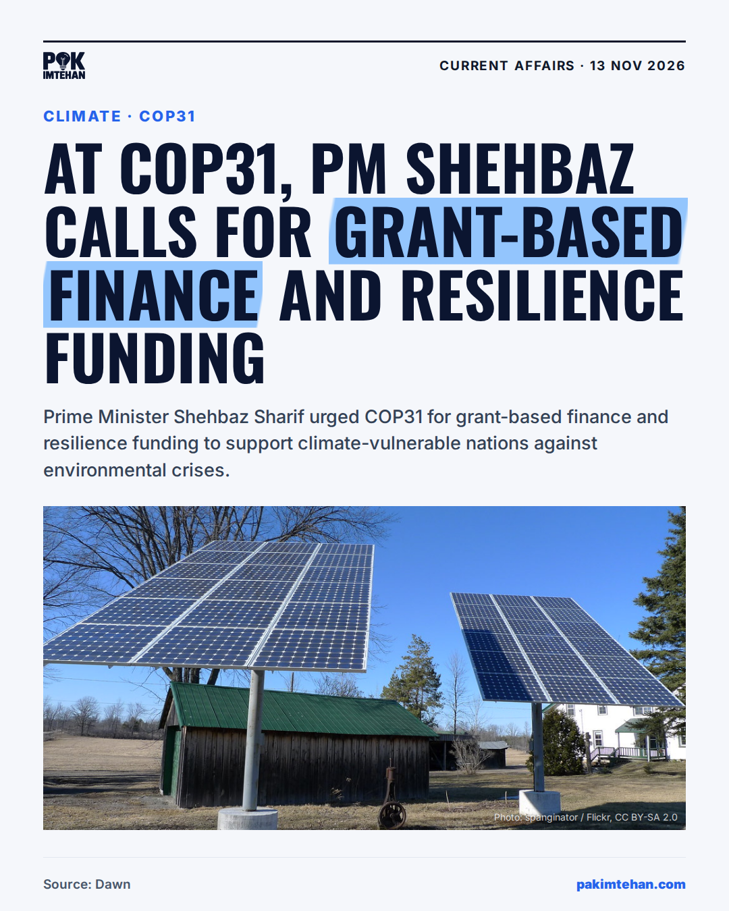
*Prime Minister Shehbaz Sharif urged COP31 for grant-based finance and resilience funding to support climate-vulnerable nations against environmental crises.*  
Template: `editorial` · Source: Dawn · Editor: `gemini:gemini-3.5-flash-lite`  
Links: [1](https://news.google.com/rss/articles/CBMiSEFVX3lxTE8xUTd0V1NPdU9lYWR1bW5kOW9FTUc2MnZXU2tsT0duRTFELVN2WVRyYWRLSzBqRWxVLVdiRnhmenBHN2RtYy1Fdw?oc=5)

### Erdogan and Shehbaz stress adhering to Islamabad MoU and vulnerable aid
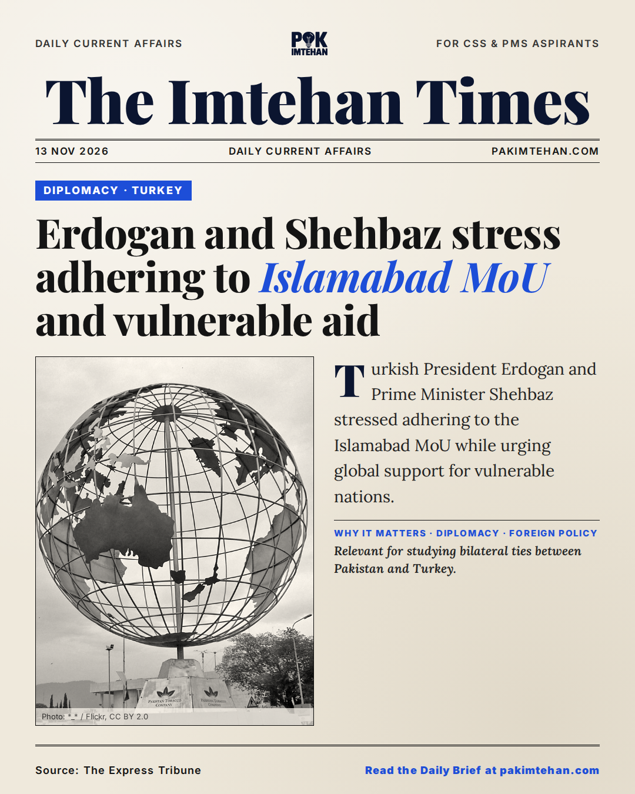
*Turkish President Erdogan and Prime Minister Shehbaz stressed adhering to the Islamabad MoU while urging global support for vulnerable nations.*  
Template: `newspaper` · Source: The Express Tribune · Editor: `gemini:gemini-3.5-flash-lite`  
Links: [1](https://tribune.com.pk/story/2640029/erdogan-shehbaz-stress-adhering-to-islamabad-mou)

### Mobilink Bank signs agreement to acquire 82.51pc stake in Apna Bank

*Mobilink Bank signed a Sale Purchase Agreement to acquire an 82.51 percent shareholding in Apna Microfinance Bank Limited, subject to regulatory approvals.*  
Template: `brief-light` · Source: Business Recorder · Editor: `gemini:gemini-3.5-flash-lite`  
Links: [1](https://www.brecorder.com/news/40448705/mobilink-bank-to-acquire-8251pc-stake-in-apna-bank)

### Punjab and Sindh face severe water shortfall threatening wheat crops
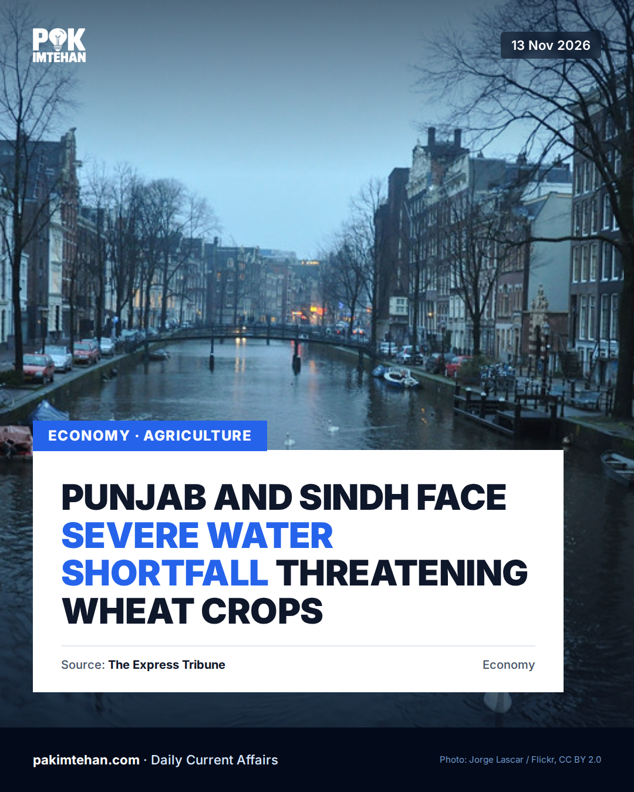
*Punjab and Sindh are facing a severe water shortfall, with the Rabi irrigation deficit posing a direct threat to wheat and winter crops.*  
Template: `breaking-photo` · Source: The Express Tribune · Editor: `gemini:gemini-3.5-flash-lite`  
Links: [1](https://tribune.com.pk/story/2640017/punjab-sindh-face-severe-water-shortfall)

### Pakistan re-elected to key UN programme and coordination committee
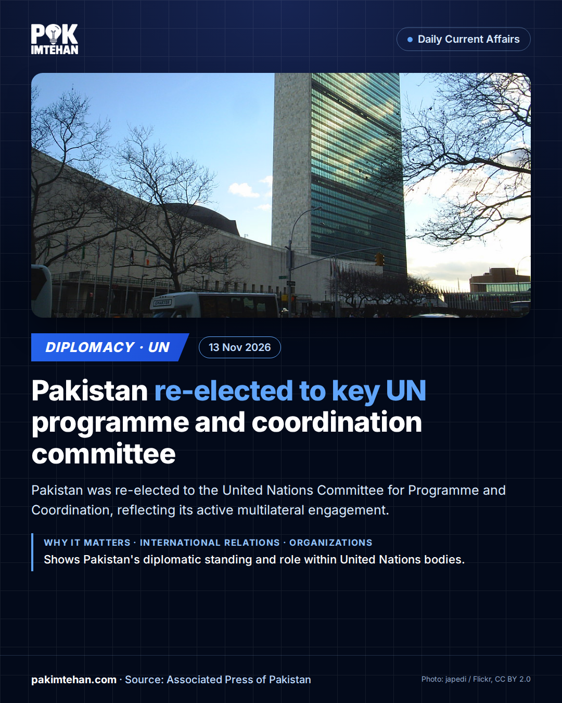
*Pakistan was re-elected to the United Nations Committee for Programme and Coordination, reflecting its active multilateral engagement.*  
Template: `navy-card` · Source: Associated Press of Pakistan · Editor: `gemini:gemini-3.5-flash-lite`  
Links: [1](https://www.app.com.pk/foreign-correspondent/pakistan-re-elected-to-key-un-programme-and-coordination-committee/)

### Naqvi suggests referendum as solution to debate on administrative units
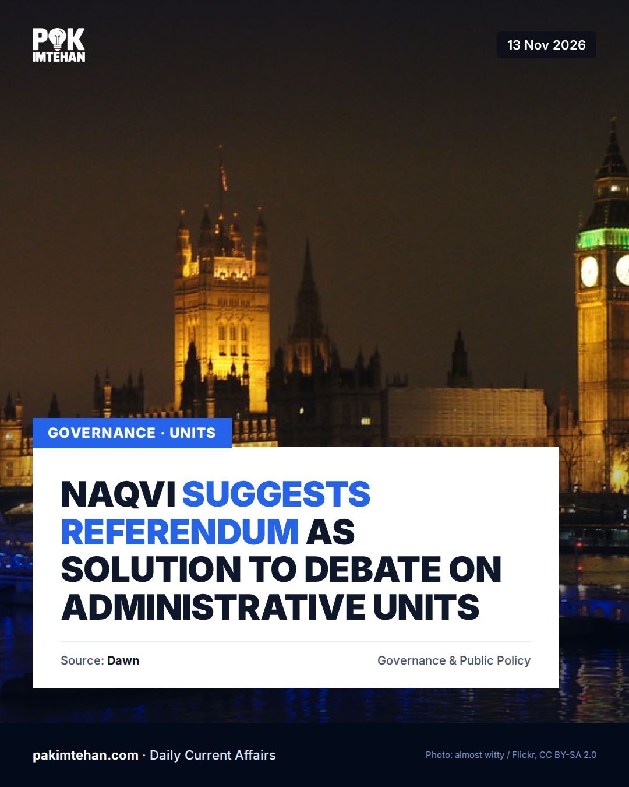
*Naqvi suggested holding a referendum as a potential solution to resolve the ongoing public and political debate on new administrative units.*  
Template: `breaking-photo` · Source: Dawn · Editor: `gemini:gemini-3.5-flash-lite`  
Links: [1](https://news.google.com/rss/articles/CBMiSEFVX3lxTE5hSHVCNy1vWVFOMHFZTHk5QTIxb0hRNzg5RVlFaXFub0JWbnNWSThTdjRwSmhvWGxTblpycHlwcFVpZVNHVDdicw?oc=5)

### Iran's Guards say they targeted US early-warning radar in Bahrain

*Iran's Revolutionary Guards announced they targeted a US early-warning radar in Bahrain, marking a significant escalation in regional tensions.*  
Template: `breaking-photo` · Source: Business Recorder, Al Jazeera · Editor: `gemini:gemini-3.5-flash-lite`  
Links: [1](https://www.brecorder.com/news/40448721/irans-guards-say-they-targeted-a-us-early-warning-radar-in-bahrain) · [2](https://www.aljazeera.com/news/2026/11/13/iran-says-it-struck-us-radar-site-in-bahrain?traffic_source=rss)

### Jensen Huang resigns as Nvidia CEO after reports of scandals

*Jensen Huang resigned as Nvidia CEO amid reports of extramarital affairs and security scrutiny, leaving the AI giant without its longtime leader.*  
Template: `breaking-photo` · Source: Dawn, Associated Press · Editor: `gemini:gemini-3.5-flash-lite`  
Links: [1](https://news.google.com/rss/articles/CBMiSEFVX3lxTE16eTFjVjlyWHNLQzF2QlVRb19rblBaT2tFeTNlMk5HNzYxZGpIZlFLQ3VqRTktZFpDLXkyY3RNVXAwRHFjRlRuaQ?oc=5) · [2](https://news.google.com/rss/articles/CBMioAFBVV95cUxOMUxqUTE0WWZBT2xoV25SLUQ2dFgyWkhwZFZyRnk3d1Fibmtrb0d4T3otSXNpNmZiTVh0QUdkWTA4UmQ3cXQyVVM3ODc0V0g4YnVVbDJRYWF4VXlaXzMzZnJWNi1UR3YyZHJGbWNzaVFab2tiM3N2RjFIOUtWcnlJVWtMVnhQNmhJeTdPajNVUXZfU2NzWkw0aGJLVFMtaGY3?oc=5)

### Jensen Huang quits Nvidia after 33 years amid alleged Chinese spy scandal

*Jensen Huang quit Nvidia after 33 years following an alleged Chinese spy scandal, prompting shareholder lawsuits and congressional queries.*  
Template: `breaking-photo` · Source: Euronews · Editor: `gemini:gemini-3.5-flash-lite`  
Links: [1](https://www.euronews.com/2026/11/12/nvidias-jensen-huang-resigns-over-relationship-with-suspected-chinese-spy)

### US envoys meet with Putin in Moscow before heading to Dublin

*US envoys met with Vladimir Putin in Moscow for Ukraine talks before traveling to Dublin to meet with Ukrainian President Volodymyr Zelenskyy.*  
Template: `breaking-photo` · Source: PBS NewsHour, NPR · Editor: `gemini:gemini-3.5-flash-lite`  
Links: [1](https://www.pbs.org/newshour/world/u-s-envoys-meet-with-putin-in-moscow-on-ukraine-talks-then-head-for-dublin-to-see-zelenskyy) · [2](https://www.npr.org/2026/11/12/nx-s1-6038809/us-envoys-meet-putin-russia-ukraine-war-talks)

### Zelensky welcomes US bringing Europe into Russia-Ukraine peace talks

*Ukrainian President Zelensky welcomed US efforts to expand the next round of Russia-Ukraine peace talks to include European nations.*  
Template: `breaking-photo` · Source: BBC News, France 24 · Editor: `gemini:gemini-3.5-flash-lite`  
Links: [1](https://www.bbc.co.uk/news/articles/ckn80j9jv3jxo?at_medium=RSS&at_campaign=rss) · [2](https://www.france24.com/en/europe/20261113-live-zelensky-and-kushner-confirm-that-europe-will-join-next-round-of-russia-ukraine-talks)

### Mississippi elects Democrat Scott Colom as state's first Black US senator

*Democrat Scott Colom won a US Senate seat in Mississippi in a stunning political upset, becoming the state's first Black senator since Reconstruction.*  
Template: `breaking-photo` · Source: Dawn, Al Jazeera · Editor: `gemini:gemini-3.5-flash-lite`  
Links: [1](https://news.google.com/rss/articles/CBMiSEFVX3lxTE9uWktQZDRUZEdaNmg2dkd5cV9ZQnk1TWotc0wwQkFwckttekR3OGlLRWR0RjNZd1lFMUI4azFLZWEwbl9HRDFYYQ?oc=5) · [2](https://www.aljazeera.com/video/newsfeed/2026/11/13/mississippi-elects-first-black-senator-in-nearly-150-years?traffic_source=rss)

### Major Microsoft Outlook outage disrupts services in dozens of countries

*Microsoft services including Outlook and Teams suffered a worldwide outage across multiple countries due to elevated infrastructure load.*  
Template: `breaking-photo` · Source: France 24, CNBC · Editor: `gemini:gemini-3.5-flash-lite`  
Links: [1](https://www.france24.com/en/technology/20261113-major-microsoft-outlook-outage-disrupts-services-in-74-countries) · [2](https://www.cnbc.com/2026/11/12/microsoft-outage-outlook-aws-google.html)

### Hungary eases abortion restrictions in women's rights overhaul

*Hungary introduced reforms easing abortion restrictions, scrapping the controversial heartbeat regulation and enhancing protections against violence.*  
Template: `breaking-photo` · Source: DW News · Editor: `gemini:gemini-3.5-flash-lite`  
Links: [1](https://www.dw.com/en/hungary-eases-abortion-restrictions-in-women-s-rights-overhaul/a-79931614?maca=en-rss-en-world-4025-rdf)

### China rules out hosting Cop33 climate summit in 2028

*China has ruled out hosting the Cop33 UN climate summit in 2028 after months of deliberations, leaving the location open.*  
Template: `breaking-photo` · Source: The Guardian · Editor: `gemini:gemini-3.5-flash-lite`  
Links: [1](https://www.theguardian.com/environment/2026/nov/12/china-rules-out-hosting-cop33-climate-summit-in-2028)
