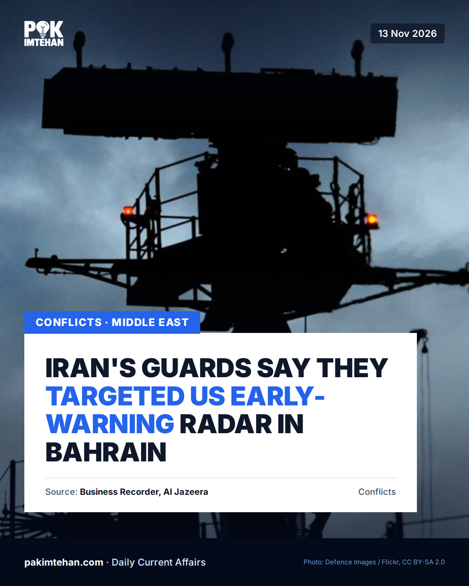
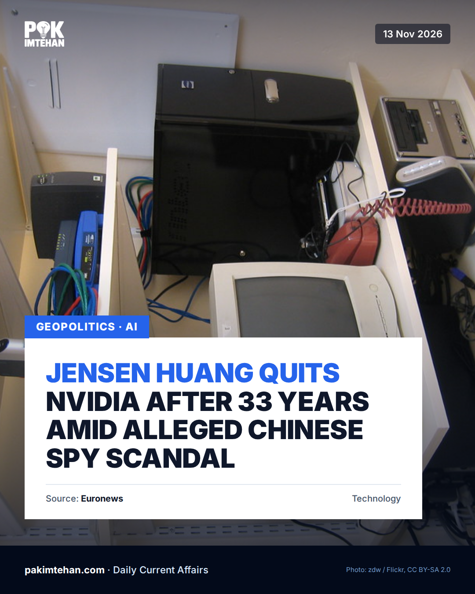
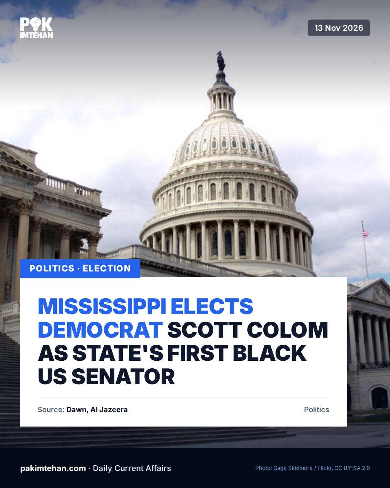
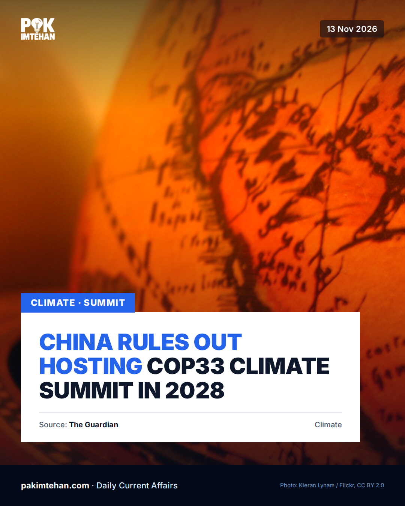

# Pak Imtehan posters - 2026-11-13

15 poster(s) in 1 batch(es).

## Batch 10:27 (Pakistan time)

### At COP31, PM Shehbaz calls for grant-based finance and resilience funding

*Prime Minister Shehbaz Sharif urged COP31 for grant-based finance and resilience funding to support climate-vulnerable nations against environmental crises.*  
Template: `editorial` · Source: Dawn · Editor: `gemini:gemini-3.5-flash-lite`  
Links: [1](https://news.google.com/rss/articles/CBMiSEFVX3lxTE8xUTd0V1NPdU9lYWR1bW5kOW9FTUc2MnZXU2tsT0duRTFELVN2WVRyYWRLSzBqRWxVLVdiRnhmenBHN2RtYy1Fdw?oc=5)

### Erdogan and Shehbaz stress adhering to Islamabad MoU and vulnerable aid

*Turkish President Erdogan and Prime Minister Shehbaz stressed adhering to the Islamabad MoU while urging global support for vulnerable nations.*  
Template: `newspaper` · Source: The Express Tribune · Editor: `gemini:gemini-3.5-flash-lite`  
Links: [1](https://tribune.com.pk/story/2640029/erdogan-shehbaz-stress-adhering-to-islamabad-mou)

### Mobilink Bank signs agreement to acquire 82.51pc stake in Apna Bank

*Mobilink Bank signed a Sale Purchase Agreement to acquire an 82.51 percent shareholding in Apna Microfinance Bank Limited, subject to regulatory approvals.*  
Template: `brief-light` · Source: Business Recorder · Editor: `gemini:gemini-3.5-flash-lite`  
Links: [1](https://www.brecorder.com/news/40448705/mobilink-bank-to-acquire-8251pc-stake-in-apna-bank)

### Punjab and Sindh face severe water shortfall threatening wheat crops

*Punjab and Sindh are facing a severe water shortfall, with the Rabi irrigation deficit posing a direct threat to wheat and winter crops.*  
Template: `breaking-photo` · Source: The Express Tribune · Editor: `gemini:gemini-3.5-flash-lite`  
Links: [1](https://tribune.com.pk/story/2640017/punjab-sindh-face-severe-water-shortfall)

### Pakistan re-elected to key UN programme and coordination committee

*Pakistan was re-elected to the United Nations Committee for Programme and Coordination, reflecting its active multilateral engagement.*  
Template: `navy-card` · Source: Associated Press of Pakistan · Editor: `gemini:gemini-3.5-flash-lite`  
Links: [1](https://www.app.com.pk/foreign-correspondent/pakistan-re-elected-to-key-un-programme-and-coordination-committee/)

### Naqvi suggests referendum as solution to debate on administrative units

*Naqvi suggested holding a referendum as a potential solution to resolve the ongoing public and political debate on new administrative units.*  
Template: `breaking-photo` · Source: Dawn · Editor: `gemini:gemini-3.5-flash-lite`  
Links: [1](https://news.google.com/rss/articles/CBMiSEFVX3lxTE5hSHVCNy1vWVFOMHFZTHk5QTIxb0hRNzg5RVlFaXFub0JWbnNWSThTdjRwSmhvWGxTblpycHlwcFVpZVNHVDdicw?oc=5)

### Iran's Guards say they targeted US early-warning radar in Bahrain

*Iran's Revolutionary Guards announced they targeted a US early-warning radar in Bahrain, marking a significant escalation in regional tensions.*  
Template: `breaking-photo` · Source: Business Recorder, Al Jazeera · Editor: `gemini:gemini-3.5-flash-lite`  
Links: [1](https://www.brecorder.com/news/40448721/irans-guards-say-they-targeted-a-us-early-warning-radar-in-bahrain) · [2](https://www.aljazeera.com/news/2026/11/13/iran-says-it-struck-us-radar-site-in-bahrain?traffic_source=rss)

### Jensen Huang resigns as Nvidia CEO after reports of scandals

*Jensen Huang resigned as Nvidia CEO amid reports of extramarital affairs and security scrutiny, leaving the AI giant without its longtime leader.*  
Template: `breaking-photo` · Source: Dawn, Associated Press · Editor: `gemini:gemini-3.5-flash-lite`  
Links: [1](https://news.google.com/rss/articles/CBMiSEFVX3lxTE16eTFjVjlyWHNLQzF2QlVRb19rblBaT2tFeTNlMk5HNzYxZGpIZlFLQ3VqRTktZFpDLXkyY3RNVXAwRHFjRlRuaQ?oc=5) · [2](https://news.google.com/rss/articles/CBMioAFBVV95cUxOMUxqUTE0WWZBT2xoV25SLUQ2dFgyWkhwZFZyRnk3d1Fibmtrb0d4T3otSXNpNmZiTVh0QUdkWTA4UmQ3cXQyVVM3ODc0V0g4YnVVbDJRYWF4VXlaXzMzZnJWNi1UR3YyZHJGbWNzaVFab2tiM3N2RjFIOUtWcnlJVWtMVnhQNmhJeTdPajNVUXZfU2NzWkw0aGJLVFMtaGY3?oc=5)

### Jensen Huang quits Nvidia after 33 years amid alleged Chinese spy scandal

*Jensen Huang quit Nvidia after 33 years following an alleged Chinese spy scandal, prompting shareholder lawsuits and congressional queries.*  
Template: `breaking-photo` · Source: Euronews · Editor: `gemini:gemini-3.5-flash-lite`  
Links: [1](https://www.euronews.com/2026/11/12/nvidias-jensen-huang-resigns-over-relationship-with-suspected-chinese-spy)

### US envoys meet with Putin in Moscow before heading to Dublin

*US envoys met with Vladimir Putin in Moscow for Ukraine talks before traveling to Dublin to meet with Ukrainian President Volodymyr Zelenskyy.*  
Template: `breaking-photo` · Source: PBS NewsHour, NPR · Editor: `gemini:gemini-3.5-flash-lite`  
Links: [1](https://www.pbs.org/newshour/world/u-s-envoys-meet-with-putin-in-moscow-on-ukraine-talks-then-head-for-dublin-to-see-zelenskyy) · [2](https://www.npr.org/2026/11/12/nx-s1-6038809/us-envoys-meet-putin-russia-ukraine-war-talks)

### Zelensky welcomes US bringing Europe into Russia-Ukraine peace talks

*Ukrainian President Zelensky welcomed US efforts to expand the next round of Russia-Ukraine peace talks to include European nations.*  
Template: `breaking-photo` · Source: BBC News, France 24 · Editor: `gemini:gemini-3.5-flash-lite`  
Links: [1](https://www.bbc.co.uk/news/articles/ckn80j9jv3jxo?at_medium=RSS&at_campaign=rss) · [2](https://www.france24.com/en/europe/20261113-live-zelensky-and-kushner-confirm-that-europe-will-join-next-round-of-russia-ukraine-talks)

### Mississippi elects Democrat Scott Colom as state's first Black US senator

*Democrat Scott Colom won a US Senate seat in Mississippi in a stunning political upset, becoming the state's first Black senator since Reconstruction.*  
Template: `breaking-photo` · Source: Dawn, Al Jazeera · Editor: `gemini:gemini-3.5-flash-lite`  
Links: [1](https://news.google.com/rss/articles/CBMiSEFVX3lxTE9uWktQZDRUZEdaNmg2dkd5cV9ZQnk1TWotc0wwQkFwckttekR3OGlLRWR0RjNZd1lFMUI4azFLZWEwbl9HRDFYYQ?oc=5) · [2](https://www.aljazeera.com/video/newsfeed/2026/11/13/mississippi-elects-first-black-senator-in-nearly-150-years?traffic_source=rss)

### Major Microsoft Outlook outage disrupts services in dozens of countries

*Microsoft services including Outlook and Teams suffered a worldwide outage across multiple countries due to elevated infrastructure load.*  
Template: `breaking-photo` · Source: France 24, CNBC · Editor: `gemini:gemini-3.5-flash-lite`  
Links: [1](https://www.france24.com/en/technology/20261113-major-microsoft-outlook-outage-disrupts-services-in-74-countries) · [2](https://www.cnbc.com/2026/11/12/microsoft-outage-outlook-aws-google.html)

### Hungary eases abortion restrictions in women's rights overhaul

*Hungary introduced reforms easing abortion restrictions, scrapping the controversial heartbeat regulation and enhancing protections against violence.*  
Template: `breaking-photo` · Source: DW News · Editor: `gemini:gemini-3.5-flash-lite`  
Links: [1](https://www.dw.com/en/hungary-eases-abortion-restrictions-in-women-s-rights-overhaul/a-79931614?maca=en-rss-en-world-4025-rdf)

### China rules out hosting Cop33 climate summit in 2028

*China has ruled out hosting the Cop33 UN climate summit in 2028 after months of deliberations, leaving the location open.*  
Template: `breaking-photo` · Source: The Guardian · Editor: `gemini:gemini-3.5-flash-lite`  
Links: [1](https://www.theguardian.com/environment/2026/nov/12/china-rules-out-hosting-cop33-climate-summit-in-2028)
